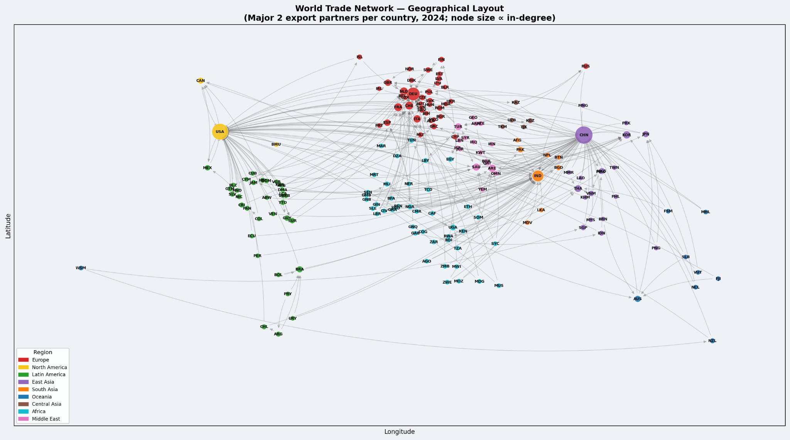
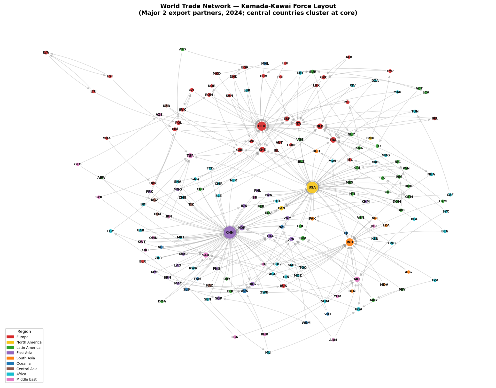
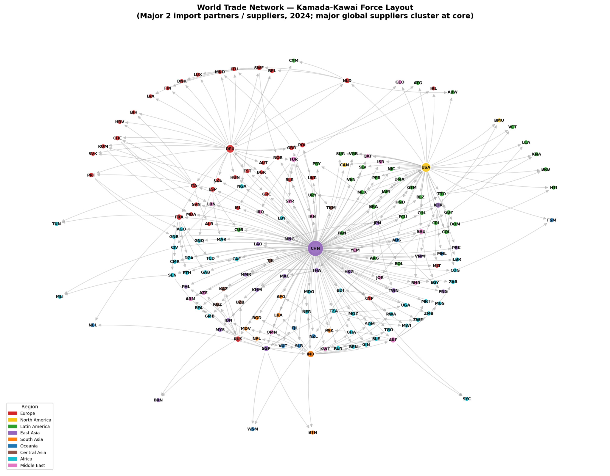
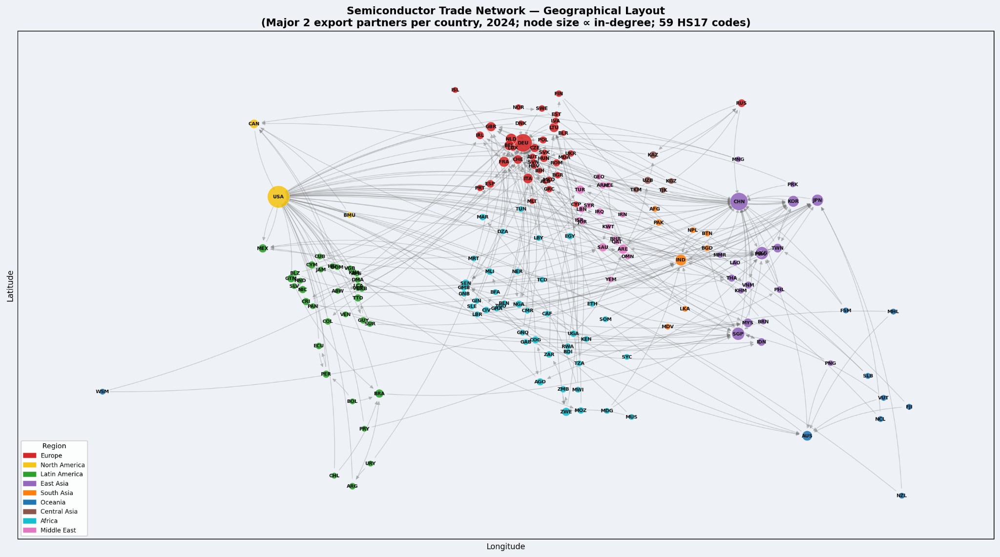
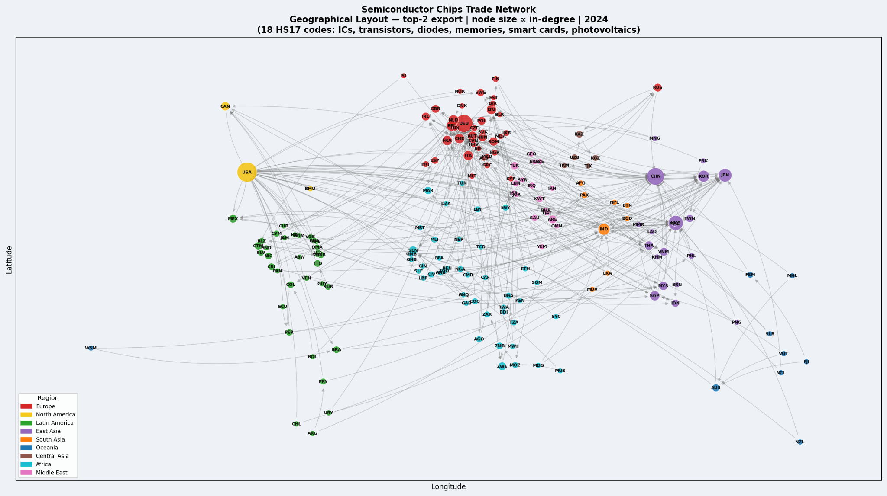
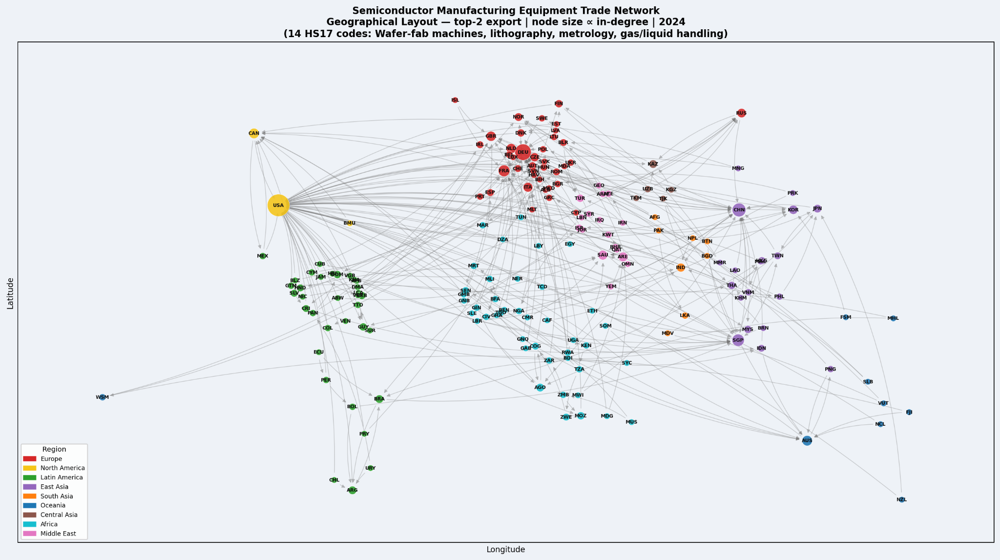

# World Trade Network Analysis | IIT Jodhpur — SURAJ 2026

**A network-science study of global trade relationships and semiconductor supply-chain dependencies**

**Research Internship:** Summer Undergraduate Research at IIT Jodhpur (SURAJ-2026)  
**Research Group:** School of Management and Entrepreneurship, IIT Jodhpur  
**Research Mentor:** Dr. Bhushan Praveen Jangam  
**Researcher:** Udit Jaiswal, NIT Delhi

---

## Overview

International trade is more than a collection of bilateral transactions: it is a complex, interconnected network. This project models countries as **nodes** and directed export flows as **weighted edges** to examine how the structure of global trade has evolved, which countries occupy influential positions, and where critical supply chains may be concentrated.

The research uses the **BACI–CEPII international trade dataset** and extends the aggregate World Trade Network (WTN) analysis to **semiconductor products**, including chips, raw materials, and manufacturing equipment.

| Research scope | Coverage |
|---|---|
| Aggregate trade dataset | BACI HS92, 1995–2024 |
| Centrality panel | 2005–2024 (20 years) |
| Countries analyzed | 175 |
| Country-year observations | 3,500 |
| Centrality indicators | 16 |
| Semiconductor analysis | BACI HS17, 2017–2024 |
| Semiconductor product codes | 59 |

## Research Objectives

- Construct **directed, weighted** international trade networks from bilateral trade records.
- Quantify countries' changing importance through network centrality metrics.
- Compare **export-side and import-side** network structures across time.
- Visualize the global trade network using geographic and **Kamada–Kawai** layouts.
- Identify trade concentration and dependencies across the semiconductor value chain.

## Methodology

### 1. Network construction

For each year, bilateral product-level trade flows are aggregated into country-to-country relationships:

- **Node:** a country or economy.
- **Directed edge:** exporter → importer.
- **Edge weight:** total bilateral export value.
- **Self-loops:** excluded.

### 2. Centrality analysis

The analysis calculates degree and strength measures, closeness and weighted closeness, and eigenvector centrality (including import/export and weighted/unweighted variants). These metrics help distinguish **number of trading partners**, **volume of trade**, **network reachability**, and **importance of connected trading partners**.

The centrality results cover **175 countries × 20 years = 3,500 country-year observations**, with **16 indicators** per observation.

### 3. Network visualization

For interpretability, the report visualizes each country's **top two** trade partners and, separately, its **single largest** partner. Both **geographical** and **Kamada–Kawai force-directed** layouts are used for 2007 and 2024, for export- and import-oriented networks.

## World Trade Network Visualizations

### Export network — geographical layout, 2024



*Actual figure extracted from the SURAJ-2026 research report: geographical view of the top-two export-partner network.*

### Export network — Kamada–Kawai layout, 2024



*Force-directed view emphasizing network structure rather than geographic proximity.*

### Import network — Kamada–Kawai layout, 2024



*Import-side perspective on countries' major sourcing relationships.*

## Semiconductor Supply Chain Extension

The second part of the research focuses on **59 HS17 product codes** for 2017–2024, grouped into three supply-chain segments:

| Segment | Examples |
|---|---|
| Chips | Integrated circuits, memory devices, transistors |
| Raw materials | Silicon, rare gases, gallium, germanium |
| Manufacturing equipment | Wafer fabrication, lithography, metrology equipment |

### Aggregate semiconductor network, 2024



### Chips trade network, 2024



### Semiconductor manufacturing equipment network, 2024



*All six images in this README are figures extracted from the original internship report—not recreated or simulated charts.*

## Key Findings

**1. China's increasing export centrality.** The report finds China's share of weighted outward trade strength rising substantially from 2005 to 2024, placing it at the center of many major export relationships.

**2. Distinct import and export hubs.** The United States remains a major import market, while China is especially prominent as a supplier. Germany remains highly connected within European and global trade networks.

**3. Persistent core–periphery structure.** Trade relationships remain concentrated around a set of highly connected economies, while emerging economies such as India, Vietnam, and Mexico gain prominence over time.

**4. Concentration in semiconductor supply chains.** Chip trade is strongly centered in East Asia; key raw materials and advanced manufacturing equipment depend on relatively few suppliers. The research highlights the Netherlands, Japan, the United States, Germany, and South Korea as important equipment-related economies.

These are findings reported in the internship research, not new independent estimates made for this README.

## Tools & Technologies

**Python · pandas · NumPy · SciPy · NetworkX · Matplotlib · Google Colab · BACI–CEPII · Network Science**

## Repository Contents

```text
World-Trade-Network-IIT-Jodhpur/
├── README.md
└── assets/
    ├── world_trade_geographic_2024.png
    ├── world_trade_kamada_kawai_2024.png
    ├── import_network_kamada_kawai_2024.png
    ├── semiconductor_network_2024.png
    ├── semiconductor_chips_2024.png
    └── semiconductor_equipment_2024.png
```

The original research report and code are **not bundled** with this README package. Research materials should be published only with the appropriate permission from IIT Jodhpur.

## Research Context & Acknowledgement

This work was carried out under **SURAJ-2026** at the **School of Management and Entrepreneurship, IIT Jodhpur**, under the mentorship of **Dr. Bhushan Praveen Jangam**. It builds on and extends the World Trade Network research approach described by **De Benedictis et al. (2013)**.

> **Research-material notice:** The internship report states that intellectual-property rights relating to the research work and its outputs belong to IIT Jodhpur, and that disclosure or publication requires prior approval. Confirm permission before making this README and its extracted figures public.
